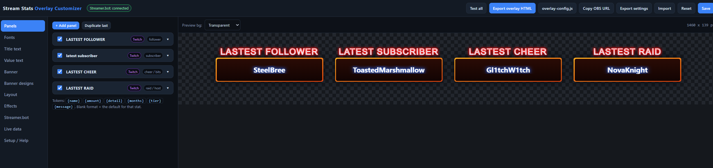

# Stream Stats Overlay

A single-file stream overlay and visual customizer for **Streamer.bot**. Shows your latest follower, subscriber, cheer, raid and more across **Twitch, Kick and YouTube** at the same time — and remembers them between streams.



No build step, no npm, no server. One HTML file you open in a browser to design, and an overlay you point OBS at.

---

## Contents

- [Features](#features)
- [Quick start](#quick-start)
- [Getting your design into OBS](#getting-your-design-into-obs)
- [Streamer.bot setup](#streamerbot-setup)
- [Panels and stats](#panels-and-stats)
- [Format tokens](#format-tokens)
- [Banner designs](#banner-designs)
- [Fonts](#fonts)
- [Effects](#effects)
- [Saved data](#saved-data)
- [Sending your own events from Streamer.bot](#sending-your-own-events-from-streamerbot)
- [Extra event mappings](#extra-event-mappings)
- [Console API](#console-api)
- [Troubleshooting](#troubleshooting)
- [Files](#files)

---

## Features

| | |
|---|---|
| **Multi-platform** | One "Latest Follower" box covers Twitch, Kick and YouTube at once. Set to a single platform instead if you prefer one box per site. |
| **Live from Streamer.bot** | Connects straight to the Streamer.bot WebSocket server. No actions, no import strings, no setup inside Streamer.bot beyond switching the server on. |
| **Remembers everything** | Values are stored the moment they arrive. Close Streamer.bot, restart OBS, reboot, come back tomorrow — the last follower, sub, cheer and raid are still on screen. |
| **Your own banner art** | Drop `banner_background.png` next to the HTML and the panels use it. |
| **196 built-in designs** | No artwork? 14 shapes x 14 colour themes, all pure CSS, plus full colour override with your own pickers. |
| **994 fonts** | 146 Windows fonts and 848 Google fonts in a searchable dropdown, plus any other Google font by name and your own font files. |
| **Effects on change only** | The animation plays when a panel's text actually changes. Reconnects, reloads and repeat events stay silent. |
| **Export for OBS** | One button writes a standalone overlay-only HTML with your design baked in. |

---

## Quick start

1. Download `stream-stats-overlay.html` and put it in a folder of its own.
2. (Optional) Put your banner art in the same folder as `banner_background.png`.
3. Open the HTML in any browser. Design your panels.
4. Click **Export overlay HTML** — it saves `overlay.html` next to it.
5. In OBS: **+ → Browser**, tick **Local file**, choose `overlay.html`.

Turn the Streamer.bot WebSocket server on and you are done.

---

## Getting your design into OBS

OBS keeps its own storage, separate from the browser you design in, so pick one of these three:

| Route | How | Best for |
|---|---|---|
| **Export overlay HTML** *(recommended)* | Click the button, drop `overlay.html` in the folder, point OBS at it as a **Local file**. | Everyone. Smallest, fastest, nothing else needed. |
| **overlay-config.js** | Click the button, drop the file next to `stream-stats-overlay.html`, point OBS at the customizer HTML as a **Local file**. | Keeping a single HTML file around. |
| **Copy OBS URL** | Click the button, paste into the browser source with **Local file** unticked. | Quick tests, or a design you want to share as a link. |

**Browser source settings**

- Width / height: the customizer prints the suggested size in the Setup tab and in the preview bar.
- Leave **Shutdown source when not visible** *off* so the stored values stay loaded.
- Custom CSS: not needed, leave it as is.

---

## Streamer.bot setup

1. Open Streamer.bot → **Servers/Clients → WebSocket Server**.
2. Tick **Enabled** and **Auto Start**.
3. Address `127.0.0.1`, port `8080`, endpoint `/` (the defaults).
4. If you switch **Authentication** on, type the same password into the overlay's Streamer.bot tab.
5. Connect your Twitch, Kick and YouTube accounts in Streamer.bot as usual.

The overlay subscribes to these events by itself:

| Source | Events |
|---|---|
| **Twitch** | `Follow` `Sub` `ReSub` `GiftSub` `GiftBomb` `Cheer` `Raid` `ChatMessage` `FirstWords` `CharityDonation` |
| **Kick** | `Follow` `Subscription` `Resubscription` `GiftSubscription` `MassGiftSubscription` `ChatMessage` `FirstWords` `ViewerCountUpdate` `RewardRedemption` |
| **YouTube** | `NewSubscriber` `NewSponsor` `MemberMileStone` `MembershipGift` `GiftMembershipReceived` `SuperChat` `SuperSticker` `Message` `FirstWords` `StatisticsUpdated` |
| **Tips** | `Streamlabs.Donation` `StreamElements.Tip` `TipeeeStream.Donation` `DonorDrive.Donation` |

Password authentication is supported and hashed in plain JavaScript, so it works from a `file://` URL where the browser's crypto API is unavailable.

---

## Panels and stats

Add as many panels as you like. Each one picks a **platform** and a **stat**:

| Stat | Fed by |
|---|---|
| Latest follower | Twitch follow, Kick follow, YouTube new subscriber |
| Latest subscriber | Twitch sub / resub, Kick subscription / resubscription, YouTube member |
| Latest gifter | Twitch gift sub / gift bomb, Kick gift subs, YouTube membership gift |
| Latest cheer | Twitch bits |
| Latest raid / host | Twitch raid |
| Latest super chat | YouTube super chat and super stickers |
| Latest tip / donation | Streamlabs, StreamElements, TipeeeStream, DonorDrive, Twitch charity |
| Viewer count | Kick viewer count, YouTube statistics |
| Latest chatter | Chat messages and first words on all three |
| Custom | Only your own broadcasts (see below) |

Per panel you can also set: title text, show/hide the amount, a custom format, its own banner image or design, title and value colours, and a size override.

**Show amount** is a checkbox on each panel. Off, a cheer reads `BitLord` instead of `BitLord - 500 bits`, and a raid reads `YTRaider` instead of `YTRaider (42 viewers)` — brackets and dashes are cleaned up too.

---

## Format tokens

Leave a panel's format blank to use the default for that stat, or write your own with these:

| Token | Meaning |
|---|---|
| `{name}` | The viewer's display name |
| `{amount}` | Bits, raid viewers, gift count, tip amount, months |
| `{detail}` | Same as amount, as plain text |
| `{months}` | Months subscribed |
| `{tier}` | Sub tier / membership level |
| `{message}` | The message attached to the event |

Examples:

```
{name}
{name} - {amount}
{name} ({amount})
{name} · {months} months
```

---

## Banner designs

With `banner_background.png` in the folder, your art is used. Without it — or by switching **Banner → Use** to *Built-in design* — you get **196** generated designs.

**14 shapes:** Rectangle · Rounded · Pill · Bevel · Cut corners · Slanted · Trapezoid · Hex · Arrow · Chevron · Flag notch · Ticket · Notch top · Double wedge

**14 colour themes:** Blue nebula · Ember · Toxic green · Royal purple · Crimson · Cyber cyan · Gold · Steel · Rose · Mint · Sunset · Vaporwave · Carbon · Ice

Filter the grid by shape or colour, and tick **Use my colours** to override any design with your own frame and fill colours, gradient angle and outer glow. With that on, the grid becomes a pure shape picker.

A single panel can use its own design by putting its id (for example `hex|ember`) in that panel's **Design id** box.

---

## Fonts

The **Fonts** tab has a search box and a live preview.

- **146 Windows fonts** — no internet needed.
- **848 Google fonts** — downloaded when the overlay loads.
- **Any other Google font** — type its exact name in *Extra Google fonts* (comma separated) and it joins the dropdowns.
- **Your own font file** — drop a `.ttf` / `.otf` / `.woff2` in the folder, name it in *Custom font file*, then pick that name.

Each of the title and value text has its own font, size, weight, colour, gradient, outline, glow, letter spacing, skew and uppercase toggle.

> If OBS runs on a machine with no internet, use a Windows font or a local font file — Google fonts will silently fall back.

---

## Effects

An effect fires **only when a panel's text changes**. A new follower plays it; a reconnect, a reload, a repaint, a window resize or an identical repeat event does not. An idle overlay stays still.

Animations: Pop · Fade · Slide up · Slide down · Slide in from right · Slide in from left · Flip · Zoom blur · Glitch · None

Extras: banner flash (with colour), banner shake, and an optional always-on idle pulse.

---

## Saved data

Every value is written to the browser source's own storage the moment it arrives, with a timestamp and the last time Streamer.bot was seen online. That survives Streamer.bot closing, OBS restarting and the PC rebooting.

**Export overlay HTML** also bakes the current names into the exported file, so even on a brand-new PC — or after clearing the OBS cache — the overlay opens showing your last follower, sub, cheer and raid instead of dashes. Live values overwrite the baked ones as soon as Streamer.bot sends something. There is a *Bake values* switch in the Layout tab if you want it off.

The **Live data** tab lets you type values in by hand, undo a wrong one, export or import the whole store, and see how long ago Streamer.bot was last up. Turn on the status chip in the Layout tab to show that on the overlay itself.

---

## Sending your own events from Streamer.bot

For anything the built-in list does not cover, add an **Execute C# Code** sub-action to any action:

```csharp
using System;

public class CPHInline
{
    public bool Execute()
    {
        string name = args.ContainsKey("user") ? args["user"].ToString() : "";
        string json = "{\"ssbOverlay\":true,"
                    + "\"stat\":\"follower\","     // follower, subscriber, giftsub, cheer, raid,
                    + "\"platform\":\"kick\","      // superchat, donation, viewers, chatter, custom
                    + "\"name\":\"" + name + "\","
                    + "\"amount\":\"\"}";
        CPH.WebsocketBroadcastJson(json);
        return true;
    }
}
```

Any message containing `"ssbOverlay": true` plus `stat`, `platform`, `name` and an optional `amount` / `detail` updates the matching panel instantly.

---

## Extra event mappings

For a Streamer.bot event the overlay does not know, add a mapping in the Streamer.bot tab:

```json
[
  {
    "event": "Kick.RewardRedemption",
    "stat": "custom",
    "platform": "kick",
    "namePath": "user.username",
    "amountPath": "reward.title"
  }
]
```

`namePath` and `amountPath` are dot paths inside the event's `data` object. The event log in the same tab shows every incoming event — mapped or not — so you can read the real field names from a live event.

---

## Console API

Available in the browser console and in the OBS browser source's interact window:

```js
StatsOverlay.set("follower", "kick", "SomeViewer", "");   // set a value by hand
StatsOverlay.config();                                     // the current design
StatsOverlay.data();                                       // the stored values
StatsOverlay.reconnect();                                  // reconnect to Streamer.bot
```

---

## Troubleshooting

| Problem | Fix |
|---|---|
| **Banner not showing in OBS** | The file name is case sensitive and must sit in the same folder as the overlay HTML. |
| **Design looks like the default in OBS** | OBS has its own storage. Re-export `overlay.html`, or use the config file or URL route. |
| **Nothing updates** | Check the event log in the Streamer.bot tab. Events arriving but panels unchanged means the panel's platform/stat pair does not match the event. |
| **Connected but no events** | That platform is not linked in Streamer.bot, or the event has a different name — fire a real one and read the log. |
| **A Google font does not apply** | The name has to match Google's spelling exactly, and the machine needs internet. |
| **Text spills out of the banner** | Raise the left/right padding in the Banner tab, or switch *Long names* to Shrink or Scroll in the Value text tab. |
| **Blurry text** | Lower the overall scale and raise the font sizes instead. |

---

## Files

```
stream-stats-overlay.html    the customizer (open this in a browser)
overlay.html                 the exported overlay for OBS
banner_background.png        optional banner art
overlay-config.js            optional, alternative to exporting
twitch.png / kick.png / youtube.png   optional badge images
yourfont.ttf                 optional custom font
```

---

Built for Streamer.bot. Use it, change it, make it yours.
